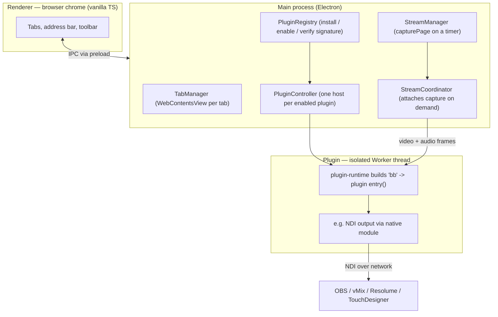

# BroadcastBrowser

A desktop browser for live video production. It renders any web page and streams
it as a professional **NDI** video source (with alpha channel and audio) into
tools like OBS, vMix, Resolume and TouchDesigner — over the local network, with
no capture card.

The browser itself contains **no output logic**. Everything — NDI output, OSC
control, timers, test patterns — lives in **sandboxed, signed plugins** that
talk to the host only through a single typed API (`bb`). This repository is a
public showcase of the architecture and selected code; the full source is
private.

> Built with Electron + TypeScript. macOS (Apple Silicon) and Windows builds are
> produced by CI. Builds available on request.

---

## Why it exists

Getting a web page into a video mixer normally means screen-capturing a browser
window — fixed resolution, no transparency, no clean audio, and whatever else is
on screen leaks in. BroadcastBrowser turns a tab into a first-class **NDI source**:
exact resolution, real alpha channel, synced audio, discoverable on the network.

## Technical highlights

- **Closed plugin architecture.** The host knows nothing about NDI or OSC. Each
  plugin runs in its own isolated **Worker thread** and reaches the browser only
  through the typed `bb` API ([`code-samples/plugin-api-contract.ts`](code-samples/plugin-api-contract.ts)).
- **Signed plugins.** In production every plugin bundle is verified with an
  **Ed25519** signature against a public key embedded in the app. Only
  first-party, signed plugins load.
- **Capability-based permissions.** A plugin declares what it needs
  (`stream.video`, `network.local`, `storage`, `ui.panel`, …); the host enforces
  it — fast-reject in the runtime, authoritatively in the main process.
- **Real-tab capture.** Video frames come from the actual tab's `WebContents`, so
  the stream mirrors exactly what renders — including page transparency for alpha.
- **OSC integration.** A multi-channel OSC transport in the host lets plugins
  bind independent UDP ports for bidirectional show control (timers, triggers,
  faders, spreadsheet-driven values).
- **Cross-platform delivery.** GitHub Actions builds signed macOS (DMG) and
  Windows (Squirrel installer with auto-update) artifacts from one tagged commit.

## Architecture at a glance

More detail: [`docs/ARCHITECTURE.md`](docs/ARCHITECTURE.md).

## Plugin ecosystem

All plugins are first-party and signed. Users install them separately, so the
browser stays a thin, generic host.

| Plugin | What it does |
|---|---|
| **NDI** | Streams the tab as NDI video + audio, with alpha-channel support |
| **OSC Timer** | Stage / broadcast timer (count-up, countdown, external) driven over OSC, multiple independent instances |
| **OSC Control** | Maps incoming OSC to web-page elements — triggers (click) and faders (input value) |
| **Sheets to OSC** | Watches cells in a Google Sheet and sends changed values over OSC |
| **Test Pattern** | Color bars, geometry grid and motion patterns at a preset or custom size |
| **Voice Indicator** | Visual voice-activity meter from the active tab's audio |

## Tech stack

- **Electron** + **TypeScript** (strict), no renderer framework (vanilla TS)
- `WebContentsView` tabs rendered above the chrome
- Plugins in **Worker threads**; native NDI via a Node addon
- **Vite** build, **ESLint**, **Vitest** (unit tests for the OSC transport,
  parameter parsing, plugin registry, signature regression, and more)
- CI/CD on **GitHub Actions** (macOS arm64 + Windows), code-signing per platform

## Code samples

This repo includes representative source, copied verbatim from the private
project, to show code style and the plugin model:

- [`code-samples/plugin-api-contract.ts`](code-samples/plugin-api-contract.ts) —
  the complete typed `bb` API surface a plugin sees.
- [`code-samples/example-plugin/`](code-samples/example-plugin/) — the full
  Test Pattern plugin (≈85 lines) and its manifest.

## License

All rights reserved. The code here is shown for review and portfolio purposes
only; it may not be reused or redistributed.
