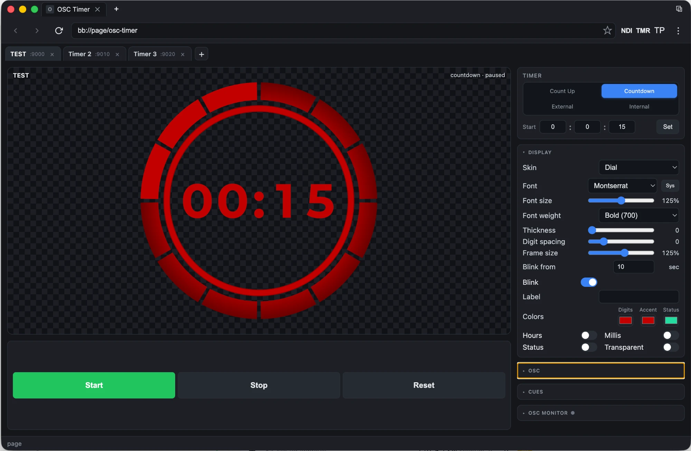
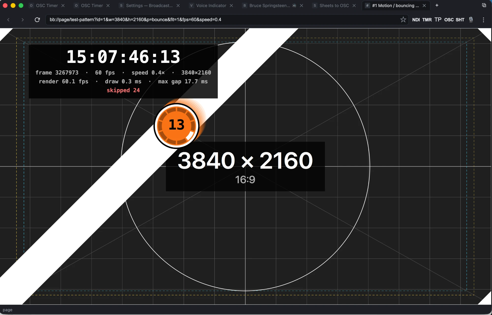
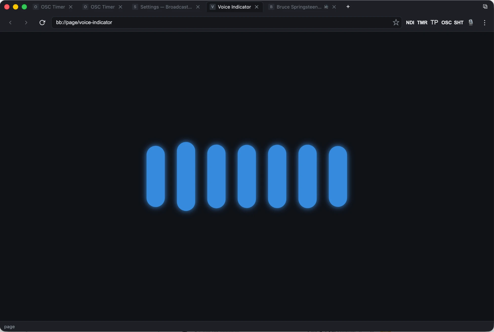
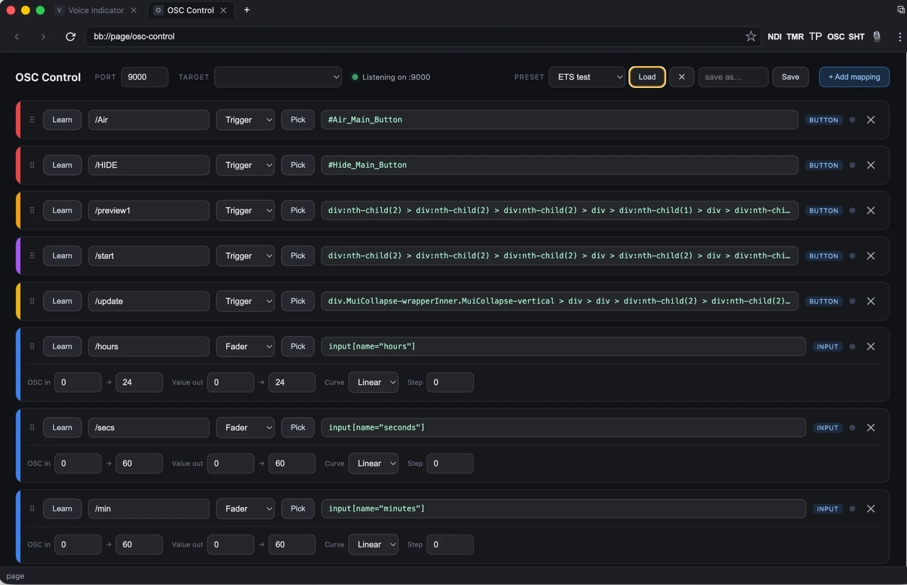
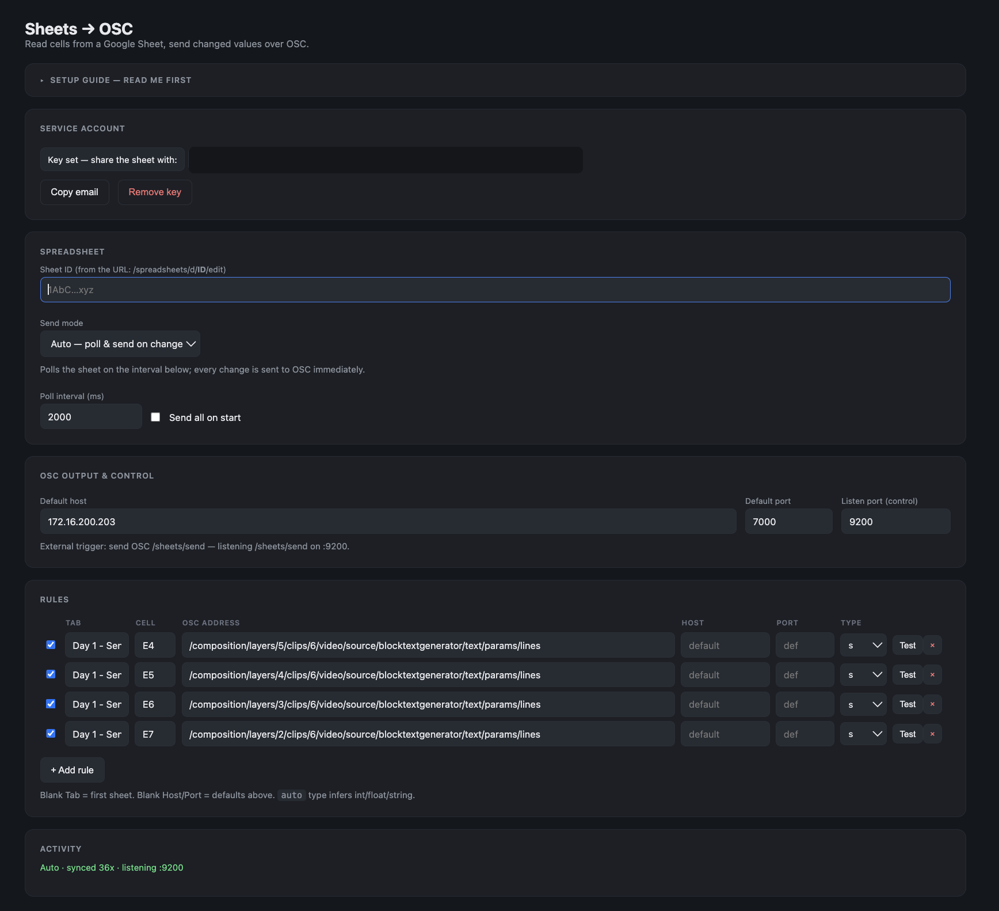
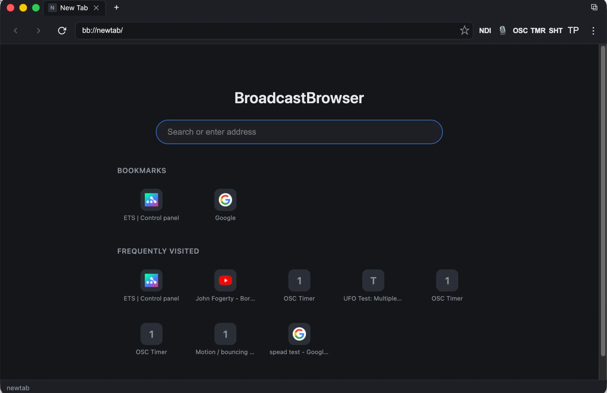
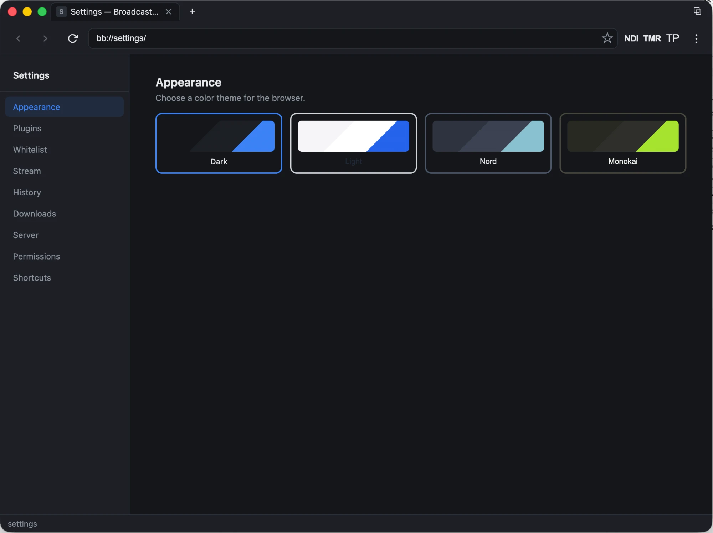
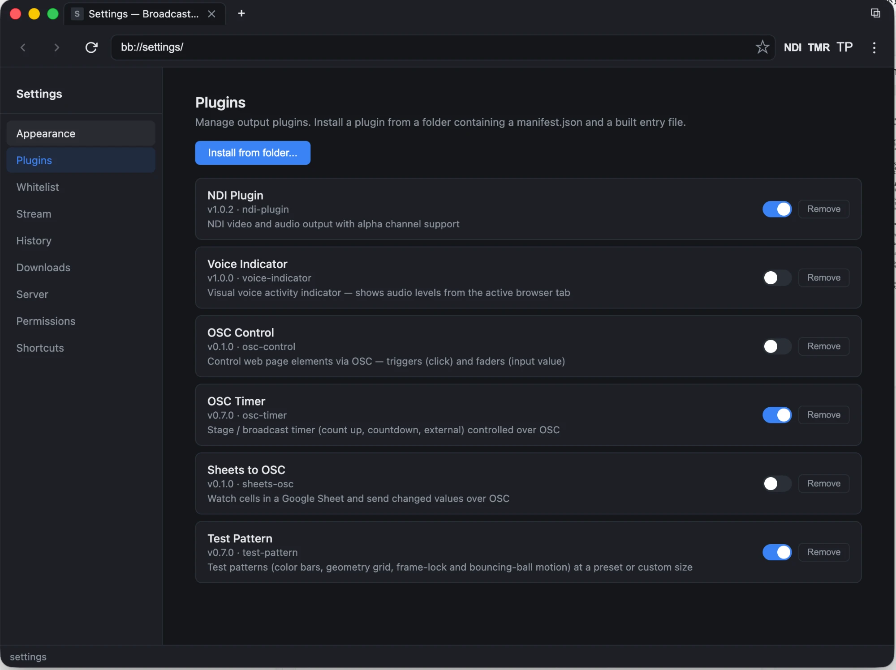
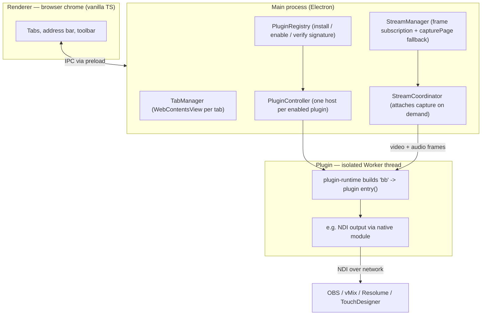

# BroadcastBrowser

Turn any web page into a broadcast-grade **NDI video source** — exact resolution,
a real alpha channel and synced audio — sent live over the network into OBS,
vMix, Resolume or TouchDesigner, with no capture card. Pages are driven over
**OSC**, so a show-control cue can change what the stream shows in real time.

> *A timer graphic driven over OSC and output with a transparent background —
> ready to composite over live video. A short screencast (OSC cue → timer
> updates → the result in OBS/Resolume over video) is coming; this is the closest
> single frame for now.*

[**Download for macOS / Windows →**](#download) · built with Electron + TypeScript · early beta, full source private (this repo is a showcase).

## Download

Early beta builds (version 0.6.3):

- **macOS (Apple Silicon):** [`BroadcastBrowser-0.6.3-arm64.dmg`](https://github.com/onovokhatski/broadcastbrowser-showcase/releases/latest)
- **Windows:** [`BroadcastBrowser-Setup.exe`](https://github.com/onovokhatski/broadcastbrowser-showcase/releases/latest)

See the [latest release](https://github.com/onovokhatski/broadcastbrowser-showcase/releases/latest)
for both files and first-launch notes (the macOS build is ad-hoc signed, so the
first open needs System Settings → Privacy & Security → **Open Anyway**).

---

## Why it exists

Getting a web page into a video mixer normally means screen-capturing a browser
window — fixed resolution, no transparency, no clean audio, and whatever else is
on screen leaks in. BroadcastBrowser removes that step: the tab itself becomes a
clean, network-discoverable source, with nothing on screen to leak.

## Context

A solo project, designed and built end to end — from the plugin architecture and
the native NDI path to cross-platform CI and signing. It started as a tool for my
own live-production work (driving shows with Resolume, TouchDesigner and QLab),
so every plugin comes from a concrete, recurring need rather than a feature list.

The point of the closed-plugin design is adaptability: a new requirement becomes a
small signed plugin against the stable `bb` API, not a fork of the browser. The
six plugins below were each built this way.

## Technical highlights

- **Generic host, tool logic in plugins.** The host provides primitives — tab
  capture, a UDP OSC transport, storage, UI surfaces — but no tool-specific
  behavior. NDI output, timer logic and OSC mappings all live in plugins, which
  reach the host only through the typed `bb` API
  ([`plugin-api-contract.ts`](code-samples/plugin-api-contract.ts)). Each plugin
  runs in its own **Worker thread**, off the UI/main event loop.
- **Trust by signing, not sandboxing.** A closed, first-party system: the browser
  loads only plugin bundles carrying a valid **Ed25519** signature from the
  publisher key embedded in the app
  ([`plugin-signature.ts`](code-samples/plugin-signature.ts)). The worker is an
  isolation and API boundary, not a container for arbitrary untrusted code — the
  trust boundary is the signature.
- **Capability-scoped API.** A plugin declares the capabilities it needs
  (`stream.video`, `network.local`, `storage`, `ui.panel`, …); the host gates the
  `bb` surface to that grant — a fast reject in the runtime and the authoritative
  check in the main process.
- **Real-tab capture.** Video frames come from the actual tab's `WebContents`, so
  the stream mirrors exactly what renders — including page transparency for alpha.
- **OSC integration.** A multi-channel OSC transport in the host lets plugins
  bind independent UDP ports for bidirectional show control (timers, triggers,
  faders, spreadsheet-driven values).
- **Cross-platform delivery.** GitHub Actions builds signed macOS (DMG) and
  Windows (Squirrel installer with auto-update) artifacts from one tagged commit.

## Screenshots

> Early beta — UI, visual design and UX are still being actively developed.

### Output & show control

**Test Pattern** — a 4K (3840×2160) alignment chart with a bouncing-ball motion
test, frame counter and a live performance overlay (render FPS, draw time,
dropped frames).

**OSC Timer** — a stage/broadcast timer with a dial skin on a transparent
background (the checkerboard is the alpha channel), running several independent
timers, each on its own OSC port.

**Voice Indicator** — an audio-level meter driven by the active tab's sound.

**OSC Control** — maps incoming OSC to page elements: triggers (clicks) and
faders (input values), with learn/pick and saved presets.

**Sheets to OSC** — rules mapping Google Sheet cells to OSC addresses
(service-account identifier redacted).

### The browser — the platform underneath

**New-tab / home page** — search, bookmarks and frequently visited pages.

**Settings → Appearance** — built-in color themes (Dark, Light, Nord, Monokai).

**Settings → Plugins** — the signed first-party plugins, installed and toggled
independently of the browser.

## Architecture at a glance

More detail: [`docs/ARCHITECTURE.md`](docs/ARCHITECTURE.md).

## Engineering highlights

A few of the harder problems behind it:

- **Up to 60 fps alpha capture, no capture card.** Frames come from the tab's
  compositor via `beginFrameSubscription` (a frame per paint). A watchdog falls
  back to `capturePage()` when the compositor stops delivering frames (a static or
  backgrounded tab), so a quiet tab keeps producing frames instead of the output
  going stale; the tab also keeps rendering off-screen. Physical vs logical frame
  size is reconciled so downstream tools get the true resolution.
  ([`stream-manager.ts`](code-samples/stream-manager.ts))
- **A closed, signed plugin system.** Each plugin bundle is verified with an
  Ed25519 signature against an embedded publisher key before it loads, with
  capability permissions enforced in both the worker and the main process.
  ([`plugin-signature.ts`](code-samples/plugin-signature.ts))
- **Multi-channel OSC.** One plugin can own several UDP endpoints at once, keyed
  by `(plugin, channel)` — e.g. a timer plugin running many independent timers,
  each on its own port, bidirectionally. ([`osc-transport.ts`](code-samples/osc-transport.ts))
- **Cross-platform native builds in CI.** The NDI native addon is rebuilt for
  macOS (Apple Silicon) and Windows on GitHub Actions. On the newest Windows
  runner image node-gyp couldn't detect Visual Studio; pinning the toolchain
  image fixed the build without vendoring the NDI SDK by hand.
- **Rendering in old embedded Chromium.** A timer skin used container-query units
  that TouchDesigner's older CEF renderer doesn't support, collapsing the layout;
  replacing them with a JS-computed sizing unit made overlays render identically
  in-app and inside the host.

## Plugin ecosystem

All plugins are first-party and signed. Users install them separately, so the
browser stays a thin, generic host.

| Plugin | What it does |
|---|---|
| **NDI** | Streams the tab as NDI video + audio, with alpha-channel support |
| **OSC Timer** | Stage / broadcast timer (count-up, countdown, external) driven over OSC, multiple independent instances |
| **OSC Control** | Maps incoming OSC to web-page elements — triggers (click) and faders (input value) |
| **Sheets to OSC** | Watches cells in a Google Sheet and sends changed values over OSC |
| **Test Pattern** | Color bars, geometry grid and motion patterns at a preset or custom size |
| **Voice Indicator** | Visual voice-activity meter from the active tab's audio |

## Tech stack

- **Electron** + **TypeScript** (strict), no renderer framework (vanilla TS)
- `WebContentsView` tabs rendered above the chrome
- Plugins in **Worker threads**; native NDI via a Node addon
- **Vite** build, **ESLint**, **Vitest** (unit tests for the OSC transport,
  parameter parsing, plugin registry, signature regression, and more)
- CI/CD on **GitHub Actions** (macOS arm64 + Windows), code-signing per platform

## Code samples

Representative source, copied verbatim from the private project, to show code
style and the problems it solves (see [`code-samples/`](code-samples/)):

- [`plugin-api-contract.ts`](code-samples/plugin-api-contract.ts) — the complete
  typed `bb` API surface a plugin sees.
- [`plugin-signature.ts`](code-samples/plugin-signature.ts) — Ed25519 plugin
  signing/verification, a pure `node:crypto` module.
- [`osc-transport.ts`](code-samples/osc-transport.ts) — the multi-channel UDP OSC
  transport (one plugin, many ports).
- [`stream-manager.ts`](code-samples/stream-manager.ts) — the real-time capture
  loop (frame subscription with a `capturePage` fallback).
- [`example-plugin/`](code-samples/example-plugin/) — the full Test Pattern
  plugin (≈85 lines) and its manifest.

Full source is available for review on request.

## License

All rights reserved. The code here is shown for review and portfolio purposes
only; it may not be reused or redistributed.
